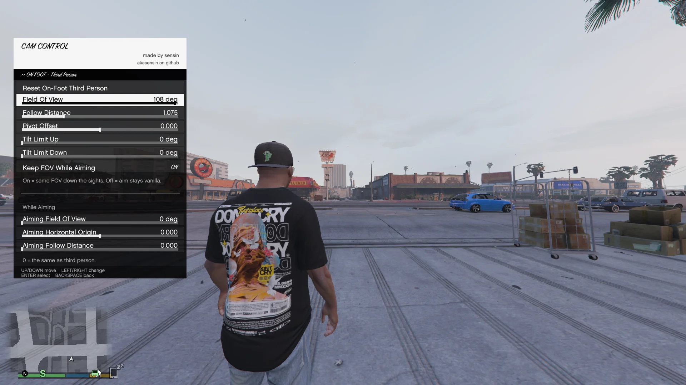
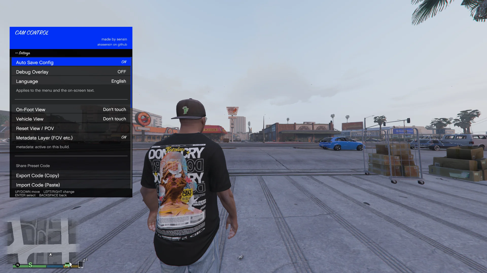
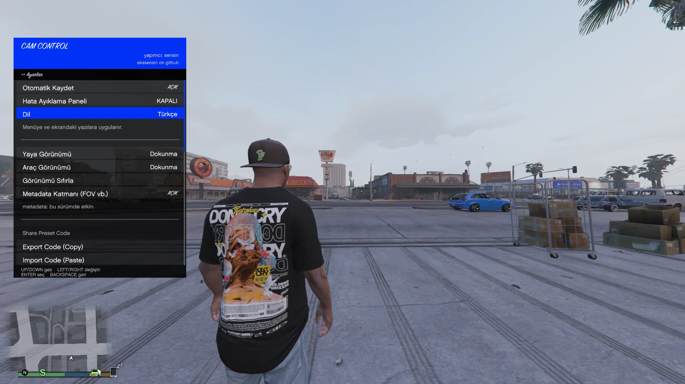
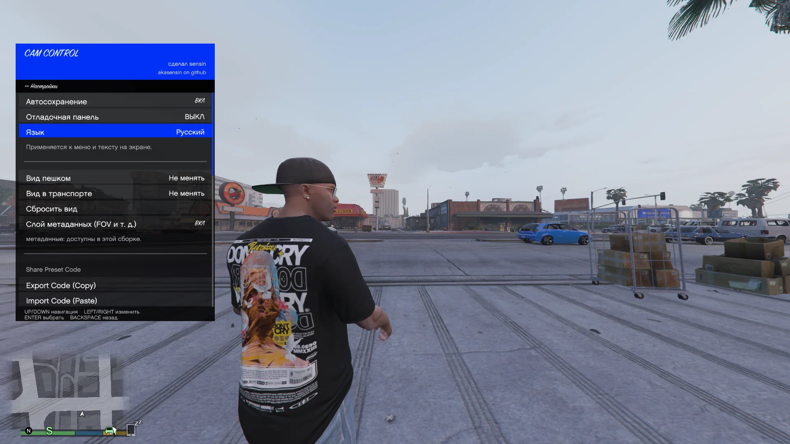

<div dir="rtl">

# Cam Control (التحكم في الكاميرا)

[](README.md)
[](LICENSE)

**made by sensin** (`akasensin` على GitHub)

مود مفتوح المصدر لـ **GTA V (أوفلاين / سنجل بلاير)** بصيغة `.asi` (ScriptHookV).
المود بيتحكم في كاميرا اللعبة **الأصلية** مباشرة من غير ما يبدل الكاميرا أو يركب كاميرا سكريبت، فالمشي والتصويب والكفر والسواقة وحركة الماوس وتصادم الكاميرا بيفضلوا طبيعيين تماماً زي اللعبة الأصلية.

على عكس المودات التانية اللي بتحقن إعداداتها جوا قائمة Pause / Settings في اللعبة (وبتضطرك تقفل اللعب وتعدل وبعدين ترجع تشوف النتيجة)، **Cam Control** بيفتح قدامك مباشرة جوا اللعب فتقدر تعدل الكاميرا و**تشوف التغييرات في الوقت الفعلي (Real-Time)**.

---

## المميزات

- **كاميرا الشخص التالت على الرجل**: التحكم في الـ FOV (في المشي والجري والتسلل والكفر والسباحة)، مسافة الكاميرا، إزاحة المحور (يمين/شمال)، حدود الميلان فوق وتحت، تعديل زاوية الميل الافتراضية (Default Pitch)، وتثبيت الـ FOV وقت التصويب مع إعدادات منفصلة للتصويب.
- **كاميرا الشخص الأول على الرجل**: التحكم في الـ FOV، إزاحة الكاميرا يمين/شمال (View Offset X)، حدود الميلان فوق وتحت، إظهار أو إخفاء نقطة التصويب بدون سلاح، واهتزاز الكاميرا.
- **كاميرا المركبات (شخص تالت)**: التحكم في الـ FOV، المسافة، إزاحة المحور يمين/شمال (Pivot Offset)، مقياس المحور، زوم المتابعة، حدود الميلان، واهتزاز الكاميرا.
- **كاميرا المركبات (شخص أول)**: التحكم في الـ FOV، إزاحة الكاميرا يمين/شمال (View Offset X)، ارتفاع الكاميرا (Z)، حدود الميلان، ومنع اللعبة من الرجوع للشخص التالت في المية أو لما العربية تبوظ.
- **FOV الأسلحة (وقت التصويب)**: التحكم في الـ FOV لكل فئة أسلحة (الافتراضي للمسدسات والرشاشات والبنادق، الـ Hip Fire، الـ RPG، الشوتجن، القنابل، الأسلحة البيضاء، السنايبر، والسكوبات التانية، وكاميرات Run & Gun).
- **كاميرات إضافية**: كاميرا البراشوت (FOV + المسافة) وكاميرا التصويب من جوا المركبات (العربيات والموتوسيكلات والمراكب والطيارات).
- **مشاركة الإعدادات بكود (من غير ملفات)**: تقدر تنسخ إعداداتك ككود `CC2:...` على الكليب بورد وتبعته لأي حد يقدر يستورده بضغطة واحدة من غير ما يغير أزراره أو لغته.
- **10 لغات**: من ضمنهم **العربية (المصرية)** مرسومة بوضوح عن طريق DirectWrite.
- **تخصيص كامل للقائمة والأزرار**: تغيير ألوان القائمة وإعادة تعيين كل الأزرار (الأزرار الافتراضية لفتح القائمة: `-` أو `F8`).

---

## اللغات المدعومة

كل اللغات العشرة مدمجة جوا المود (`الإعدادات > اللغة`):

- **English (الإنجليزية)**: This mod supports English.
- **Türkçe (التركية)**: Bu mod Türkçe dilini destekler.
- **Español (الإسبانية)**: Este mod está disponible en español.
- **Русский (الروسية)**: Этот мод поддерживает русский язык.
- **العربية المصرية (Egyptian Arabic)**: المود ده بيدعم اللغة العربية المصرية.
- **中文 (الصينية)**: 此模组支持简体中文。
- **日本語 (اليابانية)**: このMODは日本語に対応しています。
- **Deutsch (الألمانية)**: Diese Mod unterstützt Deutsch.
- **Português (البرتغالية)**: Este mod tem suporte para português.
- **Bahasa Indonesia (الإندونيسية)**: Mod ini mendukung Bahasa Indonesia.

---

## صور من جوا اللعبة

| واجهة المود | الشخص التالت على الرجل |
|---|---|
|  |  |

| خيارات ألوان الواجهة | بعد تغيير اللون |
|---|---|
|  |  |

| إعدادات الأزرار | إعدادات المود |
|---|---|
|  |  |

| التركية | الروسية | العربية (المصرية) |
|---|---|---|
|  |  |  |

---

## طريقة التثبيت

1. اتأكد إنك مثبت **ScriptHookV** متوافق مع نسخة GTA V عندك.
2. حط ملف `CamControl.asi` في **مجلد اللعبة الرئيسي** (جنب `GTA5.exe`).
3. شغّل اللعبة. كل ملفات المود (`CamControl.ini` و `CamControl.log` وملفات اللغة) بتتحفظ تلقائياً جوا:
   ```text
   GTA V\scripts\Cam Control\
   ```
4. اضغط **`-`** أو **`F8`** جوا اللعبة لفتح القائمة.

---

## نسخ اللعبة المدعومة

- **المود شغال تمام جداً على آخر تحديث لـ GTA V Legacy.**
- ممكن يشتغل كمان بدايةً من تحديث **v1.0.3717.0 ("A Safehouse in the Hills" Update)** أو نسخ أقدم لو حابب تجرب، بس يُفضل على الأقل **v1.0.3717.0**.
- **نسخة Enhanced Edition**: مفيش نسخة للـ Enhanced لأن المطور معندوش النسخة دي على الكمبيوتر.
- لو المود مشتغلش معاك على نسختك، اكتب في الكومنتات أو افتح Issue على GitHub ([akaSensin/Cam-control](https://github.com/akaSensin/Cam-control)) وهحاول أساعدك على قد ما أقدر.

---

## الفحص (VirusTotal) والمصدر المفتوح

- طبيعي جداً إن ملفات `.asi` اللي بتقرأ وتعدل في ميموري اللعبة يطلع فيها من **2 لـ 5 إنذارات كاذبة (False Positives)** من أصل ~70 برنامج حماية على VirusTotal.
- المود **مفتوح المصدر بالكامل** تحت رخصة GPL v3: تقدر تراجع الكود بنفسك (أو تخلي أي ذكاء اصطناعي / LLM يراجعهولك) وتعمله Compile بنفسك باستخدام Visual Studio / MSBuild (`CamControl.sln`, `Release | x64`).

---

## شروط خدمة Rockstar

مفيش أي ملفات أصلية من ملفات لعبة Rockstar (زي `cameras.ymt` أو ملفات XML المستخرجة من اللعبة) مرفوعة في الريبو أو مع المود احتراماً لشروط خدمة Rockstar.

---

## الرخصة

المود مرخص تحت رخصة **GNU General Public License v3.0** — راجع ملف [LICENSE](LICENSE).

</div>
