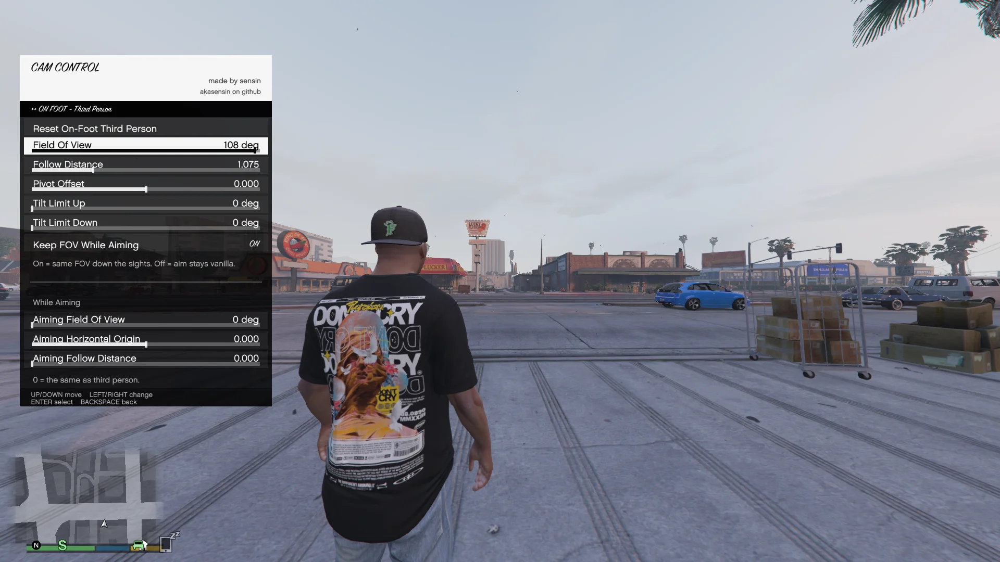
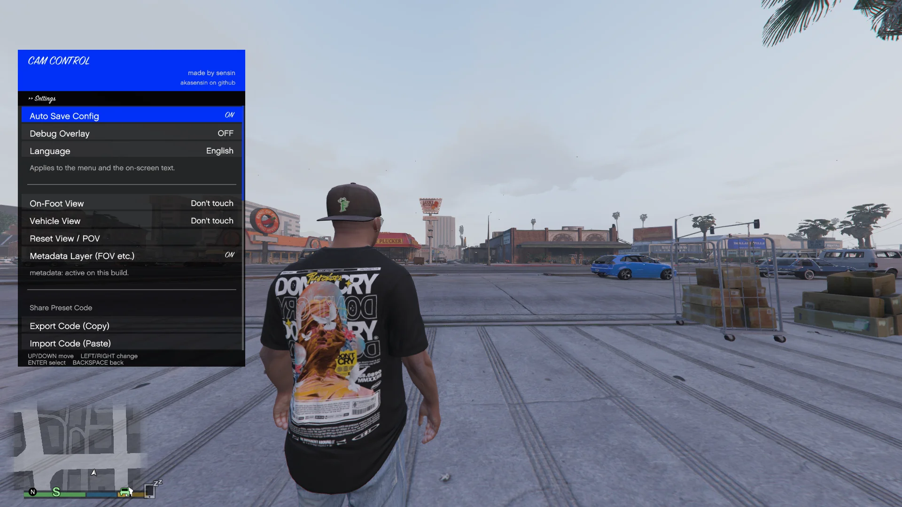
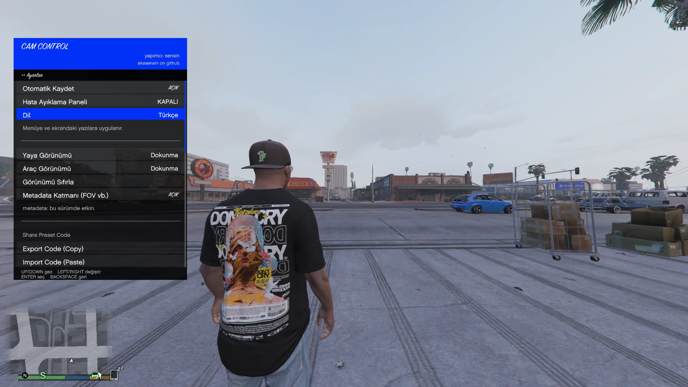
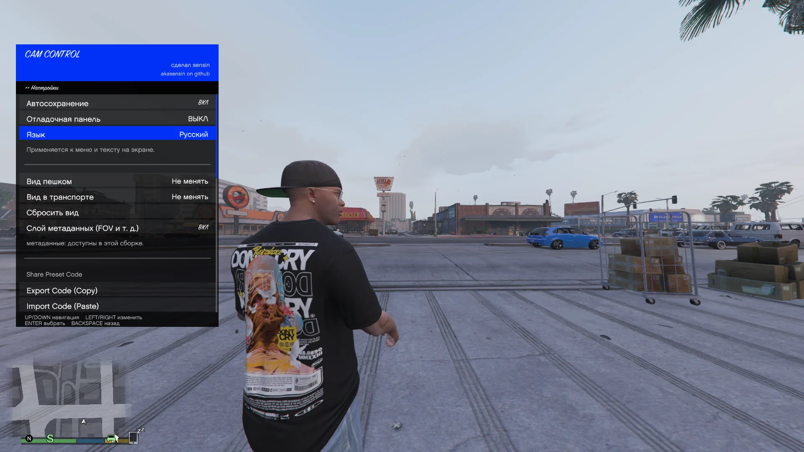

# Cam Control

[-1f6feb?style=for-the-badge)](README.ar.md)
[](LICENSE)

**made by sensin** (`akasensin` on GitHub)

An open-source ScriptHookV `.asi` camera control mod for **Grand Theft Auto V (Single Player / Offline)**.
Cam Control drives the game's **own** camera through public natives and verified camera metadata — nothing is replaced or hooked on the gameplay camera, so walking, aiming, cover, driving, camera collision, and mouse look all behave naturally.

Unlike other camera mods that inject themselves into GTA V's pause-menu Settings (forcing you to open the pause menu, adjust blindly, and unpause to check), **Cam Control** opens as a clean live overlay right in front of you so you can tweak every slider and **see the camera change in real time**.

---

## Features

- **On-Foot Third Person**: Field of View (across walk, sprint, stealth, cover, and swim), Follow Distance, Pivot Offset (left/right), Tilt Limits (Up/Down), Override Default Pitch / Default Pitch, Keep FOV While Aiming, plus separate While Aiming FOV / Horizontal Origin / Follow Distance.
- **On-Foot First Person**: Field of View, View Offset X (left/right), Tilt Limits (Up/Down), Unarmed Reticle (`Default` / `Always` / `Never`), Camera Shake.
- **Vehicle Third Person**: Field of View, Follow Distance, Pivot Offset (left/right), Pivot Scale, Follow Zoom, Tilt Limits (Up/Down), Camera Shake.
- **Vehicle First Person**: Field of View, View Offset X (left/right), View Offset Z (up/down), Tilt Limits (Up/Down), Keep First Person In Water, Keep First Person When Wrecked.
- **Weapons (Aiming FOV)**: Per-class aiming FOV for Default (pistols/SMG/rifles/MG), Hip Fire, RPG / Launchers, Shotgun, Thrown, Melee / Animals, Digiscanner, Jerry Can, Sniper, Sniper (Low Zoom), and Other Scopes / Aim (including Run-and-Gun and Cinematic Shooting cameras).
- **Extra Cameras**: Parachute Field of View & Follow Distance, plus Drive-By / Vehicle Weapon Aiming FOV (cars, bikes, boats, helicopters).
- **Share Preset Code (No File Needed)**: Export your settings as a compact `CC2:...` clipboard code and import codes shared by other players (`CC1:` / `CC2:`) without overwriting your keybinds or language.
- **10 Languages**: English, Turkish, Spanish, Russian, Arabic (Egyptian), Chinese, Japanese, German, Portuguese, and Indonesian (with DirectWrite rendering for Arabic, CJK, and accented Latin).
- **Customizable UI**: Accent colour presets, custom RGB sliders, and full key rebinding (no numpad required; default open keys `-` and `F8`).

---

## Supported Languages

All 10 languages are built directly into the mod (`Settings > Language`):

- **English**: This mod supports English.
- **Türkçe (Turkish)**: Bu mod Türkçe dilini destekler.
- **Español (Spanish)**: Este mod está disponible en español.
- **Русский (Russian)**: Этот мод поддерживает русский язык.
- **العربية المصرية (Egyptian Arabic)**: المود ده بيدعم اللغة العربية المصرية.
- **中文 (Chinese)**: 此模组支持简体中文。
- **日本語 (Japanese)**: このMODは日本語に対応しています。
- **Deutsch (German)**: Diese Mod unterstützt Deutsch.
- **Português (Portuguese)**: Este mod tem suporte para português.
- **Bahasa Indonesia (Indonesian)**: Mod ini mendukung Bahasa Indonesia.

---

## Screenshots

| Mod UI | On-Foot Third Person |
|---|---|
|  |  |

| UI Colour Options | After Colour Change |
|---|---|
|  |  |

| Key Bindings | Mod Settings |
|---|---|
|  |  |

| Turkish | Russian | Egyptian Arabic |
|---|---|---|
|  |  |  |

---

## Installation

1. Install **ScriptHookV** matching your GTA V Legacy version.
2. Place `CamControl.asi` in your **GTA V root folder** (next to `GTA5.exe`).
3. Launch the game. All mod data files (`CamControl.ini`, `CamControl.log`, and optional `lang_<code>.txt` overrides) are automatically stored inside:
   ```text
   GTA V\scripts\Cam Control\
   ```
4. Press **`-`** or **`F8`** in game to open the menu.

---

## Game Version Support

- **Works perfectly on the latest GTA V Legacy version.**
- It can also work starting from **v1.0.3717.0 ("A Safehouse in the Hills" Update)** or even older versions if you want to try — at least **v1.0.3717.0** is recommended.
- **GTA V Enhanced Edition**: No Enhanced Edition build is provided because the author does not own Enhanced Edition on PC.
- If the mod does not work on your game version or setup, please report it in the comments or open an issue on GitHub ([akaSensin/Cam-control](https://github.com/akaSensin/Cam-control)) and I will try to help as much as I can.

---

## Antivirus / VirusTotal & Open Source

- Unsigned C++ `.asi` mods that read and write game memory can sometimes trigger **2 to 5 false-positive flags out of ~70 vendors** on VirusTotal. This is normal for ScriptHookV `.asi` plugins.
- This project is **100% open source** under GPL v3: you can inspect the source code yourself (or ask any AI / LLM to review it) and compile it yourself with Visual Studio / MSBuild (`CamControl.sln`, `Release | x64`).

---

## Rockstar Terms of Service

No original Rockstar game files (such as `cameras.ymt` or extracted game XMLs) are shipped or shared in this repository or in any release, in respect of Rockstar Terms of Service.

---

## License

Licensed under the **GNU General Public License v3.0** — see [LICENSE](LICENSE).
